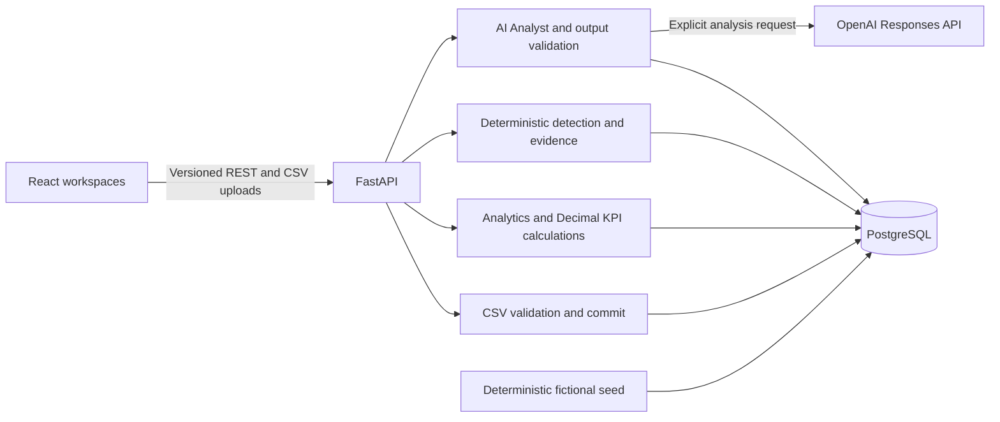

# Architecture

CampaignIQ is a local, single-workspace marketing analytics application for the fictional Northstar Outfitters brand.

## Backend

- `app/main.py` defines the versioned API, request errors, and OpenAPI schema.
- `app/config.py`, `app/db.py`, and `app/models.py` configure local settings, sessions, and SQLAlchemy models.
- `app/domain.py` and `app/schemas.py` define reporting contexts and API types.
- `app/validation.py` reads UTF-8 CSV with Python's standard CSV parser and parses numeric fields into integers or Decimal before database writes. This workload fits a bounded row-oriented parser.
- `app/imports.py` classifies rows in preview and again at commit, and persists campaign-days alongside import history.
- `app/analytics.py` filters and groups raw measures in SQL, checks attribution compatibility, and passes raw totals to `app/metrics.py`. Campaign sorting occurs after aggregation so ratio columns sort by their actual KPI values.
- `app/seed.py` loads deterministic campaign history with a source marker.
- `app/detection*.py` prepares mature evidence, applies rule gates, and persists run audits with findings and suppressions.
- `app/ai_*.py` snapshots persisted evidence, uses the Responses API on explicit request, checks grounding, and preserves analysis history.
- `alembic/` contains the versioned PostgreSQL schema.

## Frontend

React Router provides Overview, Campaigns and campaign detail, Insights, AI Analyst, and Data Imports. TanStack Query manages HTTP request states and invalidates reporting, evidence and history caches after new imports or detection runs. The date, platform, campaign, and table controls are reflected in the URL. Tailwind and local shadcn/ui components provide the visual primitives, and Recharts plots the API's daily values. Frontend presentation code formats dates and metrics.

## API

All application endpoints use `/api/v1`. OpenAPI is available at `/docs` and `/openapi.json`.

| Method and path | Behavior |
| --- | --- |
| `GET /health` | Checks the PostgreSQL connection |
| `GET /campaigns`, `GET /analytics/campaigns` | Filtered, sorted campaign reports with pagination |
| `GET /campaign-options` | Paginated campaign identifiers and names for filters |
| `GET /campaigns/{id}` | Campaign metadata |
| `GET /campaigns/{id}/performance` | Campaign totals, daily series, targets and date coverage |
| `GET /analytics/overview`, `GET /analytics/trends`, `GET /analytics/platforms` | Filtered aggregate, daily and platform reports |
| `POST /imports/preview`, `POST /imports/commit` | Validate or persist a multipart canonical CSV |
| `GET /imports`, `GET /imports/{id}` | Paginated audit history and per-import validation issues |
| `POST /detection/runs`, `GET /detection/runs` | Manual deterministic run and run history |
| `GET /detection/runs/{id}`, `GET /detection/runs/{id}/suppressions` | Run audit and suppressed policy decisions |
| `GET /insights`, `GET /insights/summary`, `GET /insights/{id}`, `GET /campaigns/{id}/insights` | Findings, current run counts, and evidence |
| `GET /ai/status`, `GET /ai/analyses/{id}` | Server availability and saved analysis |
| `POST /insights/{id}/analyses`, `GET /insights/{id}/analyses` | Explicit interpretation request and its audit history |

Report filters accept inclusive `start_date`, `end_date`, `platform` and the internal integer `campaign_id`. Campaign lists also accept `status`, `sort`, `direction`, `page`, and `page_size`. Pagination is one-based, with a maximum page size of 100. Blank filters in the UI use all available reporting dates and platforms. Undefined ratios serialize as JSON null. Decimals and counts above JavaScript's safe integer range serialize as strings. Error responses use an `error` object containing `code`, `message`, and optional `details`.

The dev configuration is intended for a trusted local operator. Hosting a shared workspace requires authentication and an authorization model.
